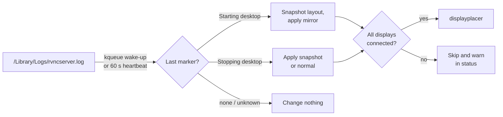

# How it works



## Detection reads RealVNC's log, not a port

iPad connections go through RealVNC's cloud relay over UDP, so checking TCP port 5900 never sees them. Instead, mirrormax reads `/Library/Logs/rvncserver.log`. RealVNC Server writes:

- `SServerAgent: Starting desktop` when a session starts, and
- `SServerAgent: Stopping desktop` when it ends.

Whichever marker came last is the current state. If there is no marker at all (for example right after a log rotation), the state is **unknown** and nothing changes.

## Switching

On connect
:   Snapshot the current layout (`displayplacer list`), then apply your `mirror` layout.

On disconnect
:   Apply the snapshot. If the snapshot is missing or names displays that are gone, apply your saved `normal` layout instead.

Once per transition
:   mirrormax remembers its mode in `~/.local/state/mirrormax/state.json`, so it switches at most once per connect or disconnect, even if the log is re-read.

One switcher at a time
:   A lock file stops two mirrormax processes (for example a manual `mirrormax mirror` and the agent) from switching at the same moment.

## Drift check

A layout is only applied if **every display it names is connected**. If you're on a different dock or a monitor is off, the switch is skipped and `mirrormax status` tells you why (*Display drift*). Fix it by re-saving the layout with your current hardware:

```sh
mirrormax layout list
mirrormax layout save normal
```

You can override the check for a single manual apply with `mirrormax layout apply NAME --force`.

## Watch mode (the default)

The agent runs `mirrormax watch`: a long-running process that sleeps in kqueue (`EVFILT_VNODE`) on the log file and wakes the instant RealVNC writes to it. It uses no CPU while idle. It also re-checks every 60 seconds (the *heartbeat*), so a missed event or a sleep/wake can't leave you stuck.

### Why watch and not polling?

The old agent spawned a tiny zsh script every 5 seconds. Spawning a Python CLI (with Typer, Rich and loguru imports) every 5 seconds costs much more CPU per run, so a long-running watcher is cheaper. To measure it on your Mac:

```sh
brew install hyperfine
hyperfine 'mirrormax check'
```

Other options that were considered:

- **kqueue** is Apple's recommended way to watch a *single file*, and it's in Python's standard library (`select`).
- **FSEvents-based libraries** (`watchdog`, `watchfiles`) are built for directory trees and add latency and dependencies.
- **launchd's `WatchPaths`** was rejected: `launchd.plist(5)` calls it race-prone, and it has a history of silently stopping.

### Poll mode (fallback)

If watch mode ever misbehaves, switch to the old every-few-seconds behaviour:

```sh
mirrormax agent install --mode poll
```

In poll mode launchd runs `mirrormax check` every `poll_interval` seconds (5 by default).

## Shadow mode

While the legacy `com.maxludden.vnc-mirror` agent is loaded or enabled, mirrormax never touches the displays. It logs *Would mirror* / *Would restore* instead and `status` shows `◐ Shadow mode`. See [Migrating from vnc-mirror](../getting-started/migrating.md).

## Code layout

| Module | Responsibility |
|---|---|
| `detector` | RealVNC log → session state |
| `layouts` | displayplacer arguments |
| `displays` | display backend protocol and the displayplacer backend |
| `state` | atomic JSON state and the lock |
| `controller` | the state machine that decides when to switch |
| `watcher` | kqueue watcher and heartbeat |
| `agent` | launchd plist and `launchctl` |
| `legacy` | shadow mode, migrate and rollback |
| `doctor`, `status` | diagnostics |
| `ui`, `jsonout` | Rich theme and renderers, JSON output |
| `cli` | the Typer app (thin) |
